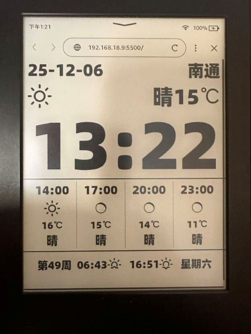
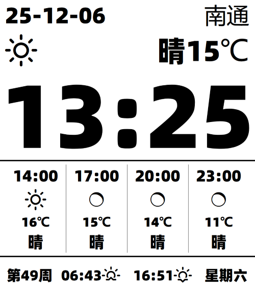
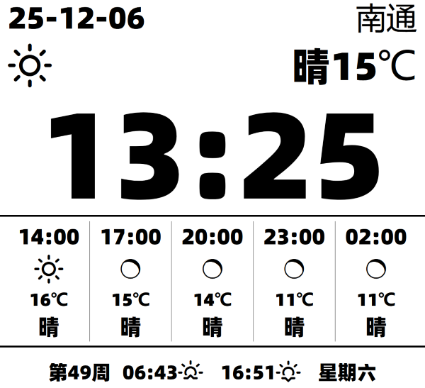

# Kindle 时钟和天气预报

原理：利用 Kindle 的内置浏览器 访问 H5 页面

注：参考原作：https://github.com/0111/Kindle_WeatherCN

手里是一台 7 代的 Kindle，在显示原作时页面有些超出屏幕范围，因此手动改造了一版。

相对原作主要改动如下：

- 大幅修改了 kindle.css，去掉了所有定位布局系统，换成了 webkit 版的 flexbox（老 kindle 内置浏览器不支持现代 flexbox）；
- 重新制作了字体，基于阿里巴巴普惠体，工具和方法放在./fontTool；
- 修改了日期、城市和当前天气的显示；
- network.js，天气缓存、15 秒超时、失败退避重试、独立 JSONP 回调；校时成功后每 6 小时同步；
- 时钟、日期、日历、夜间模式、校时和两类天气请求分别捕获异常，互不拖累；
- 接入新的请求逻辑、校验天气数据；时钟和日期独立更新，天气失败也能继续走；
- 默认时区跟随天气接口返回的城市 UTC 偏移量，修改城市后，时钟、日期、预报及日出日落时间都会使用该城市时区。

## 第一步：关闭屏幕休眠模式

最新的 kindle 系统已经无法在搜索框中输入： ～ ds 来关闭屏保，必须越狱。

- 安装 WinterBreak
- 安装 KUAL 和 KUAL Helper

操作参考：

- https://bookfere.com/post/406.html
- https://bookfere.com/post/1145.html
- https://bookfere.com/post/311.html
- https://bookfere.com/post/477.html

## 第二步：用 Kindle 浏览器打开时钟

访问页面：[Kindle 时钟和天气预报](https://linlinw5.github.io/kindle_clock/)。可以将此地址加入 Kindle 浏览器书签。

点击页面右上角的城市名称进入配置页，可设置城市、时区、温度单位，以及自己的 OpenWeather Appid-Key。

城市可以填写为“城市名,国家简写”，使用英文逗号分隔，例如 `shanghai,CN`（中国上海）、`toronto,CA`（加拿大多伦多），避免匹配到其他国家的同名城市。

## 备注

config.js 中 cityNameDB 收录了中国和加拿大的多个知名城市，如果自己所在的城市未列入，则右上角会显示拼音，可以自行添加自己城市的中文名到 cityNameDB。

添加后，如果现有字体没有包含这些汉字，需要使用 [fontTool](./fontTool/readme.md) 重新构建字体。在仓库根目录运行：

```sh
uv run --no-project --python 3.14 --with "fonttools>=4.61,<5" python fontTool/build_font.py
```

脚本会自动补入城市名用字，并直接更新 `css/PuHuiTiMin.ttf`。

## 效果图






